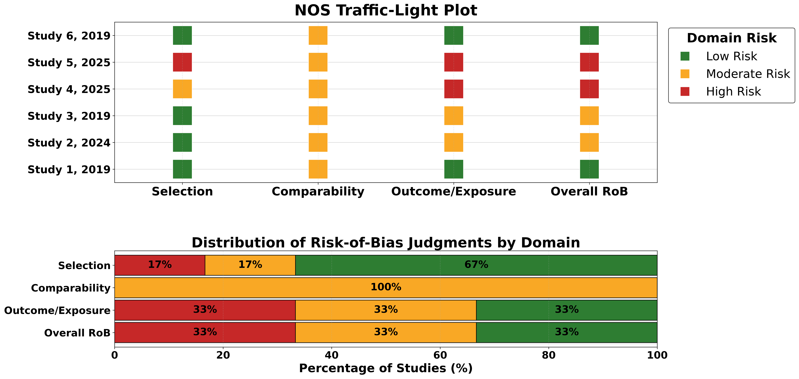
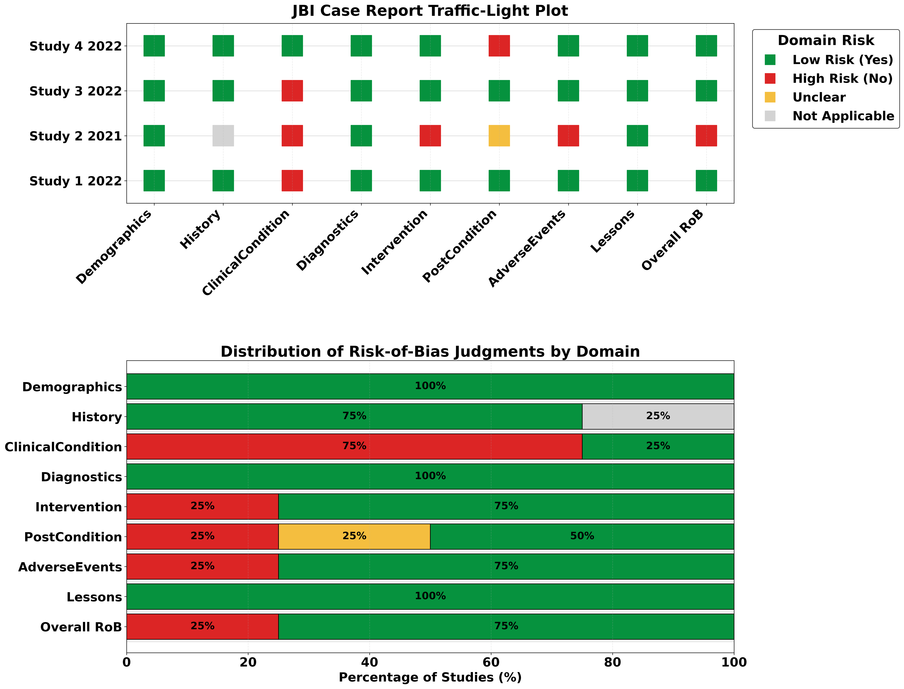
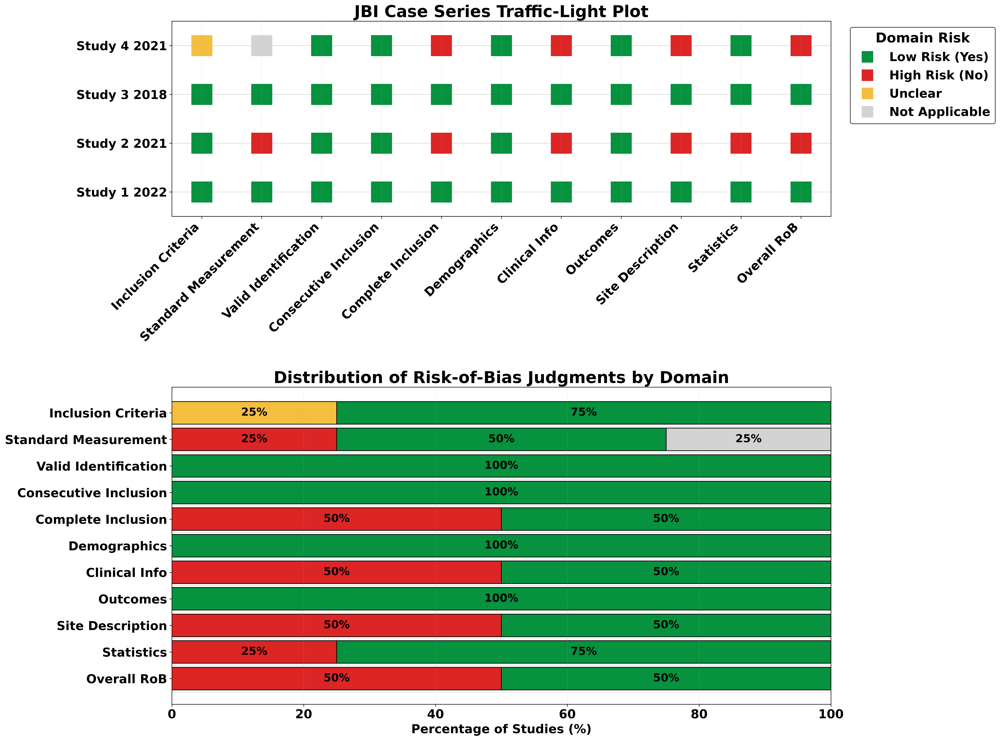
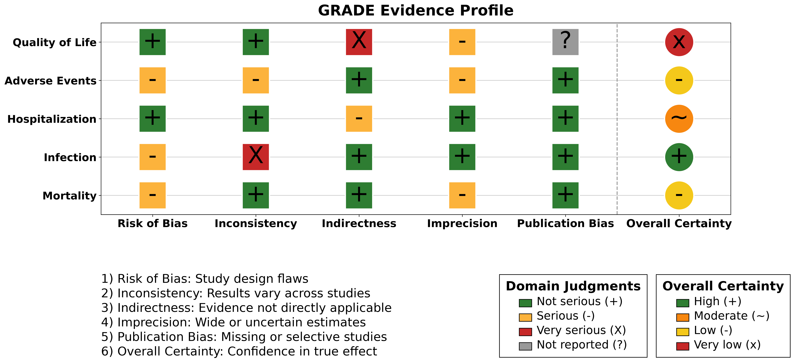
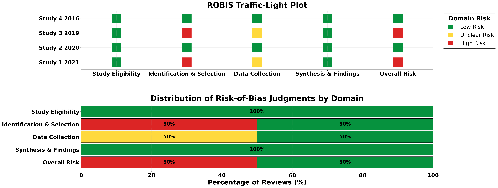
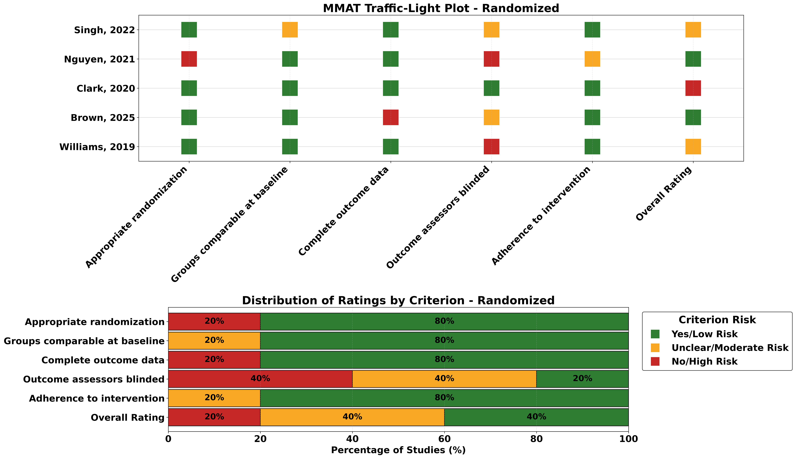
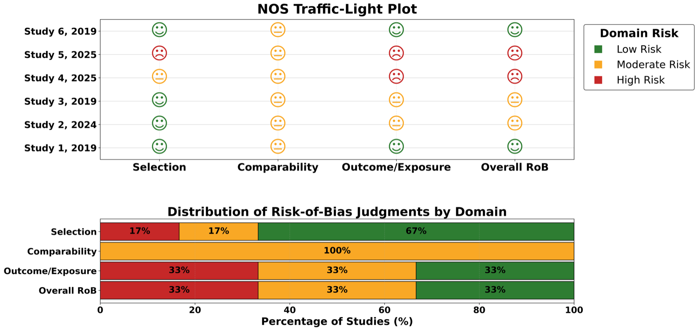
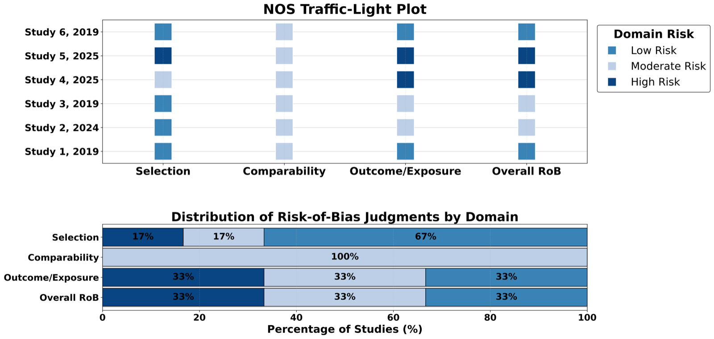
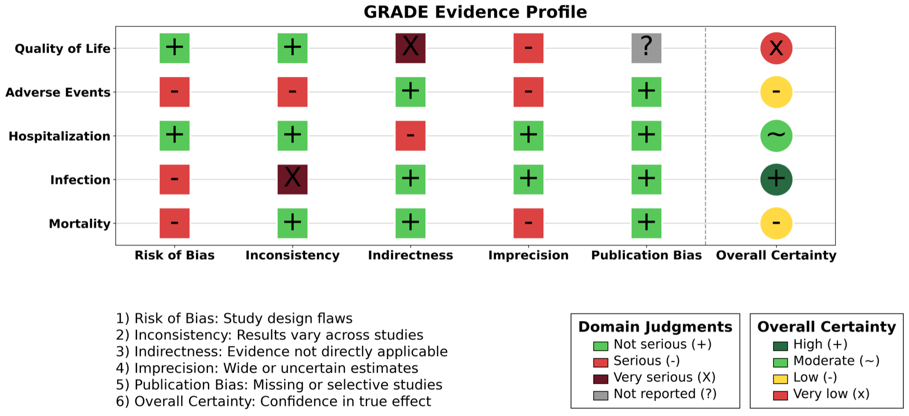

# critiplotR


<!-- badges: start -->
[](https://doi.org/10.5281/zenodo.17236600)
<!-- badges: end -->

**critiplotR** is an R interface to [**critiplot**](https://pypi.org/project/critiplot/), an open-source tool for visualizing **risk-of-bias (RoB) assessments** in systematic reviews and meta-analyses. It produces **publication-ready traffic-light plots** and **stacked bar charts** for:

| Function | Assessment |
|---|---|
| `plot_nos()` | Newcastle-Ottawa Scale (NOS) |
| `plot_jbi_case_report()` | JBI critical appraisal checklist for case reports |
| `plot_jbi_case_series()` | JBI critical appraisal checklist for case series |
| `plot_grade()` | GRADE certainty of evidence |
| `plot_robis()` | ROBIS (Risk Of Bias In Systematic reviews) |
| `plot_mmat()` | Mixed Methods Appraisal Tool (MMAT) |

---

## Contents

1. [Installation](#installation)
2. [Python setup](#python-setup)
3. [Quick start](#quick-start)
4. [How to use critiplotR in R](#how-to-use-critiplotr-in-r)
5. [Input data reference](#input-data-reference)
6. [Themes and output formats](#themes-and-output-formats)
7. [Return values](#return-values)
8. [Seeing the Python messages](#seeing-the-python-messages)
9. [Using plots in R Markdown and Quarto](#using-plots-in-r-markdown-and-quarto)
10. [Bundled example data](#bundled-example-data)
11. [Troubleshooting](#troubleshooting)
12. [Example gallery](#example-gallery)
13. [Citation](#citation)
14. [Related links](#related-links)

---

## Installation

### From CRAN

```r
install.packages("critiplotR")
```

### Development version from GitHub

```r
# install.packages("pak")
pak::pak("aurumz-rgb/critiplotR")

# or
# install.packages("remotes")
remotes::install_github("aurumz-rgb/critiplotR")
```

### From a source tarball

```r
install.packages("critiplotR_0.2.0.tar.gz", repos = NULL, type = "source")
```

### Install the Python backend manually

`critiplotR` calls the Python package `critiplot`. If you prefer to manage
Python yourself, install it into the interpreter that reticulate uses:

```r
reticulate::py_install("critiplot", pip = TRUE)
```

or from a terminal:

```bash
pip install "critiplot>=2.1.1"
```

## Python setup

`critiplotR` requires **Python >= 3.9** and **critiplot >= 2.1.1**. The
version is a minimum: `pip` installs the newest release that satisfies it.
You have three options.

### Option 1: Let reticulate manage Python (easiest)

On load, `critiplotR` declares its Python dependency with
`reticulate::py_require("critiplot>=2.1.1")`. If no other Python installation
is found, reticulate creates a managed environment and installs `critiplot`
(plus `numpy`, `pandas`, `matplotlib`, `seaborn`, `pyarrow`, and `openpyxl`)
the first time you create a plot. The first call therefore takes a few
minutes; later calls are fast because the environment is cached.

```r
library(critiplotR)
plot_nos(system.file("extdata", "sample_nos.csv", package = "critiplotR"), "nos.png")
```

### Option 2: Use an existing virtual environment or conda environment

```r
reticulate::virtualenv_create("critiplot-env", packages = "critiplot")
reticulate::use_virtualenv("critiplot-env", required = TRUE)

# or
reticulate::conda_create("critiplot-env", packages = "critiplot")
reticulate::use_condaenv("critiplot-env", required = TRUE)
```

Call `use_virtualenv()` / `use_condaenv()` **before** the first plot call in
the session.

### Option 3: Use a specific system Python

```r
Sys.setenv(RETICULATE_PYTHON = "/path/to/python3")
```

To make this permanent, add the same line to your `~/.Renviron`, then restart R.
Alternatively use `reticulate::use_python("/path/to/python3", required = TRUE)`.

### Verify the setup

```r
reticulate::py_config()                     # which interpreter is used
reticulate::py_module_available("critiplot") # must be TRUE
```

`py_config()` also prints the versions of Python and reticulate that you
should include when reporting a problem.

If Python itself is missing, reticulate can install one:

```r
reticulate::install_python()
```

## Quick start

```r
library(critiplotR)

# Create a NOS plot from the bundled example file
out <- plot_nos(
  input_file  = system.file("extdata", "sample_nos.csv", package = "critiplotR"),
  output_file = "nos.png"
)

out
#> [1] "/path/to/nos.png"
```

Open `nos.png` with any image viewer, or inside R:

```r
utils::browseURL(out)
```

## How to use critiplotR in R

Every plotting function has the same interface:

```r
plot_xxx(input_file, output_file, theme = "default", verbose = FALSE)
```

* `input_file`: a data frame, or a path to a `.csv`, `.xls`, or `.xlsx` file.
* `output_file`: path for the plot; the extension must be `.png`, `.pdf`,
  `.svg`, or `.eps`.
* `theme`: colour theme (see [Themes and output
  formats](#themes-and-output-formats)).
* `verbose`: if `TRUE`, print the messages emitted by the Python package.

### Plot from an existing CSV or Excel file

```r
plot_robis(
  input_file  = "my_robis_data.xlsx",
  output_file = "figures/robis.pdf"
)
```

The output directory must already exist. The package never modifies your
input file.

### Plot from a data frame

`input_file` also accepts a data frame, so you can read, filter, or reshape
your data in R and pass it straight to a plotting function. The data frame is
written to a temporary CSV for Python and removed when the call finishes.

```r
# Read a CSV without mangling the column names
dat <- read.csv("my_nos_data.csv", check.names = FALSE)

# Read an Excel file without mangling the column names
dat <- readxl::read_excel("my_nos_data.xlsx", .name_repair = "minimal")

# Inspect the names before plotting
names(dat)

plot_nos(dat, "nos.png")
```

The same works for a subset of studies, a data frame built from scratch, or a
`tibble`:

```r
low_risk <- subset(dat, `Overall RoB` == "Low")
plot_nos(low_risk, "nos-low.png")
```

If your column names are already mangled (`Overall.RoB` instead of
`Overall RoB`), rename them first:

```r
names(dat) <- gsub("\\.", " ", names(dat))
# or, for a single column:
names(dat)[names(dat) == "Overall.RoB"] <- "Overall RoB"
```

### Plot all themes in a loop

```r
input <- system.file("extdata", "sample_nos.csv", package = "critiplotR")

for (theme in c("default", "blue", "gray", "smiley", "smiley_blue")) {
  plot_nos(
    input_file  = input,
    output_file = sprintf("nos-%s.png", theme),
    theme       = theme
  )
}
```

### Plot MMAT categories

MMAT data can contain several study categories. `critiplot` writes one file
per category, appending `_<category>` to the output name:

```r
files <- plot_mmat(
  input_file  = system.file("extdata", "sample_mmat.csv", package = "critiplotR"),
  output_file = "mmat.png"
)

files
#> [1] ".../mmat_Descriptive.png"   ".../mmat_Mixed Methods.png"
#> [3] ".../mmat_Non-randomized.png" ".../mmat_Qualitative.png"
#> [5] ".../mmat_Randomized.png"
```

Use the returned vector to include the files in a report:

```r
knitr::include_graphics(files)
```

## Input data reference

Use the exact names shown below. `plot_grade()` accepts underscores or spaces
(`Risk_of_Bias` or `Risk of Bias`), and the JBI functions accept `Author,Year`,
`Author, Year`, or separate `Author` and `Year` columns. Column order does not
matter.

### NOS: `plot_nos()`

| Column | Notes |
|---|---|
| `Author, Year` | One column containing author and year, separated by a comma and space. In a CSV the header must be quoted: `"Author, Year"`. |
| `Representativeness` | Star value, 0-5 |
| `Non-exposed Selection` | Star value, 0-5 |
| `Exposure Ascertainment` | Star value, 0-5 |
| `Outcome Absent at Start` | Star value, 0-5 |
| `Comparability (Age/Gender)` | Star value, 0-5 |
| `Comparability (Other)` | Star value, 0-5 |
| `Outcome Assessment` | Star value, 0-5 |
| `Follow-up Length` | Star value, 0-5 |
| `Follow-up Adequacy` | Star value, 0-5 |
| `Total Score` | Numeric total |
| `Overall RoB` | `"Low"`, `"Moderate"`, or `"High"` |

### JBI case report: `plot_jbi_case_report()`

```text
Author,Year
Demographics, History, ClinicalCondition, Diagnostics,
Intervention, PostCondition, AdverseEvents, Lessons
Total, Overall RoB
```

The author column can be named `Author,Year`, `Author, Year`, or supplied as
two separate columns `Author` and `Year`. Domain values accept
`"Yes"`/`"No"`/`"Unclear"`/`"Not Applicable"`, `1`/`0`, or
`"Low"`/`"High"`. `Total` is numeric and `Overall RoB` is
`"Low"`/`"High"`/`"Unclear"`/`"Not Applicable"`.

### JBI case series: `plot_jbi_case_series()`

```text
Author,Year
InclusionCriteria, StandardMeasurement, ValidIdentification,
ConsecutiveInclusion, CompleteInclusion, Demographics, ClinicalInfo,
Outcomes, SiteDescription, Statistics
Total, Overall RoB
```

Domain values follow the same rules as the case-report plot.

### GRADE: `plot_grade()`

| Column | Accepted values |
|---|---|
| `Outcome` | Free text |
| `Risk_of_Bias` (or `Risk of Bias`) | `"Not serious"`, `"Serious"`, `"Very serious"`, `"Not reported"` |
| `Inconsistency` | Same as above |
| `Indirectness` | Same as above |
| `Imprecision` | Same as above |
| `Publication_Bias` (or `Publication Bias`, `Other Considerations`) | Same as above |
| `Overall_Certainty` (or `Overall Certainty`) | `"High"`, `"Moderate"`, `"Low"`, `"Very low"` |

Value matching is case-insensitive and tolerates variants such as
`"not_serious"` and `"very serious"`. Missing values are treated as
`"Not serious"`.

### ROBIS: `plot_robis()`

```text
Review
Study Eligibility Criteria
Identification & Selection of Studies
Data Collection & Study Appraisal
Synthesis & Findings
Overall RoB
```

Judgements accept `"Low"`, `"High"`, `"Unclear"` (case-insensitive; `"L"`,
`"H"`, and `"U"` also work).

### MMAT: `plot_mmat()`

| Column | Notes |
|---|---|
| `Author_Year` | Study label |
| `Study_Category` | One of `"Qualitative"`, `"Randomized"`, `"Non-randomized"`, `"Descriptive"`, `"Mixed Methods"` |
| `Overall_Rating` | `"Yes"`, `"No"`, `"Can't tell"`, `"High"`, `"Moderate"`, or `"Low"` |
| all other columns | Treated as appraisal criteria; each value must be `"Yes"`, `"No"`, or `"Can't tell"` |

One plot is produced per value of `Study_Category`.

## Themes and output formats

| Function | Themes |
|---|---|
| `plot_nos()`, `plot_robis()`, `plot_jbi_case_report()`, `plot_jbi_case_series()`, `plot_mmat()` | `"default"`, `"blue"`, `"gray"`, `"smiley"`, `"smiley_blue"` |
| `plot_grade()` | `"default"`, `"green"`, `"blue"` |

The `"smiley"` themes draw smiley faces instead of coloured squares (traffic
light plots) for NOS, ROBIS, JBI, and MMAT.

Supported output formats are PNG (300 dpi), PDF, SVG, and EPS. Choose the
format through the file extension:

```r
input <- system.file("extdata", "sample_nos.csv", package = "critiplotR")

plot_nos(input, "nos.png")  # raster, 300 dpi
plot_nos(input, "nos.pdf")  # vector, for manuscripts
plot_nos(input, "nos.svg")  # vector, for editing or the web
plot_nos(input, "nos.eps")  # vector, for journal submission
```

## Return values

All functions return the path(s) of the files they created, invisibly. This
makes it easy to chain plotting and reporting:

```r
nos_file <- plot_nos(
  system.file("extdata", "sample_nos.csv", package = "critiplotR"),
  "nos.png"
)
knitr::include_graphics(nos_file)

mmat_files <- plot_mmat(
  system.file("extdata", "sample_mmat.csv", package = "critiplotR"),
  "mmat.png"
)  # one file per study category
```

They also fail early with a clear R error if the input file is missing, the
extension is unsupported, the output directory does not exist, or the theme
name is invalid.

## Seeing the Python messages

`critiplot` prints progress and diagnostic messages (for example, warnings
about total-score mismatches). These are captured by default so that the
functions are silent and work under every locale. Use `verbose = TRUE` to
relay them to the R console:

```r
input <- system.file(
  "extdata", "sample_jbi_case_series.csv", package = "critiplotR"
)
plot_jbi_case_series(input, "jbi.png", verbose = TRUE)
```

## Using plots in R Markdown and Quarto

````markdown
```{r}
library(critiplotR)

plot_nos(
  input_file  = "data/nos.csv",
  output_file = "figures/nos.png"
)
```


````

For a figure caption and automatic sizing, use `knitr::include_graphics()`:

````markdown
```{r, fig.cap = "Risk of bias across studies (NOS)."}
knitr::include_graphics("figures/nos.png")
```
````

## Bundled example data

The package ships with one CSV and one XLSX file per plot type:

```r
list.files(system.file("extdata", package = "critiplotR"))
```

```text
sample_grade.csv           sample_grade.xlsx
sample_jbi_case_report.csv  sample_jbi_case_report.xlsx
sample_jbi_case_series.csv  sample_jbi_case_series.xlsx
sample_mmat.csv            sample_mmat.xlsx
sample_nos.csv             sample_nos.xlsx
sample_robis.csv           sample_robis.xlsx
```

Use them as templates for your own data:

```r
input <- system.file("extdata", "sample_jbi_case_report.xlsx",
                     package = "critiplotR")
plot_jbi_case_report(input, "jbi.png")
```

## Troubleshooting

### Check the basics first

```r
reticulate::py_config()
reticulate::py_module_available("critiplot")
reticulate::py_run_string("import critiplot; print(critiplot.__file__)")
```

`py_module_available()` must return `TRUE`. If it returns `FALSE`, Python is
either not installed, or the package is installed in a different interpreter
than the one reticulate is using.

### "The 'critiplot' Python package is not available"

Install the module into the interpreter that reticulate uses, then restart R:

```r
reticulate::py_install("critiplot", pip = TRUE)
```

If you use a virtual environment or conda environment, activate it first with
`reticulate::use_virtualenv()` / `reticulate::use_condaenv()`.

### reticulate is using the wrong Python

```r
# Temporary, for this session only
Sys.setenv(RETICULATE_PYTHON = "/path/to/python3")

# Permanent
usethis::edit_r_environ()
# add: RETICULATE_PYTHON=/path/to/python3
```

Restart R after changing `RETICULATE_PYTHON`. On Windows the path often looks
like `C:/Users/you/AppData/Local/Programs/Python/Python312/python.exe`.

### Python is not installed

```r
reticulate::install_python(version = "3.12")
```

Then restart R and check `reticulate::py_config()` again.

### "Missing required columns"

The column names in your file do not match the expected spelling. Common
causes:

* `read.csv()` replaces spaces with dots in column names. Read with
  `check.names = FALSE`, or rename the columns.
* The NOS author column must be one column named `Author, Year`, which has to
  be quoted in a CSV header: `"Author, Year"`.
* MMAT uses underscores: `Author_Year`, `Study_Category`, `Overall_Rating`.
* GRADE accepts both `Risk_of_Bias` and `Risk of Bias`; the other plot types
  expect the exact names listed in [Input data reference](#input-data-reference).

Print `names(your_data)` and compare it with the reference above.

### XML/Excel errors

Reading `.xlsx` files needs the Python package `openpyxl`. It is installed
automatically with `critiplot`, but if you installed `critiplot` manually:

```r
reticulate::py_install("openpyxl", pip = TRUE)
```

Legacy `.xls` files are converted in R first and need the `readxl` package:

```r
install.packages("readxl")
```

If you do not have `readxl`, save the file as `.xlsx` or `.csv` instead.

### Unicode errors with older versions

Versions before 0.2.0 failed with
`UnicodeEncodeError: 'ascii' codec can't encode character '\u2705'` when R
used a non-UTF-8 locale (`LC_CTYPE=C`). Upgrade to critiplotR >= 0.2.0, which
captures the Python output. As an extra precaution you can also set a UTF-8
locale:

```r
Sys.setlocale("LC_CTYPE", "en_US.UTF-8")  # macOS/Linux
```

### Theme errors

Only the themes listed in [Themes and output
formats](#themes-and-output-formats) are valid. `plot_grade()` does **not**
support `"gray"`, `"smiley"`, or `"smiley_blue"`.

### "Unsupported output file type"

Use `.png`, `.pdf`, `.svg`, or `.eps`. Also make sure the output directory
already exists and that you have permission to write to it.

### MMAT produced several files

This is expected: one file per value of `Study_Category`. `plot_mmat()`
returns all of them.

### Plots are slow the first time

The first call may install Python packages into reticulate's managed
environment. Subsequent calls reuse the cached environment. If you are
offline, point reticulate at an interpreter that already has `critiplot`
installed.

### Headless Linux server / no display

Matplotlib may try to open a GUI backend. Force the non-interactive backend
before Python starts:

```r
Sys.setenv(MPLBACKEND = "Agg")
library(critiplotR)
```

### Still stuck?

Open an issue at <https://github.com/aurumz-rgb/critiplotR/issues> and include
the output of:

```r
sessionInfo()
reticulate::py_config()
reticulate::py_module_available("critiplot")
```

## Example gallery

The plots below were generated from the bundled example data
(`inst/extdata/`) with the default theme, using this one-liner pattern:

```r
plot_nos(
  system.file("extdata", "sample_nos.csv", package = "critiplotR"),
  "nos.png"
)
```

### Newcastle-Ottawa Scale

<figure>
  
  <figcaption><strong>NOS traffic-light plot</strong> — <code>plot_nos()</code>. One row per study, one column per domain, plus a stacked bar chart of the judgements.</figcaption>
</figure>

### JBI checklists

<figure>
  
  <figcaption><strong>JBI case report</strong> — <code>plot_jbi_case_report()</code>. Each study is judged on the eight JBI case-report domains.</figcaption>
</figure>

<figure>
  
  <figcaption><strong>JBI case series</strong> — <code>plot_jbi_case_series()</code>. Each study is judged on the ten JBI case-series domains.</figcaption>
</figure>

### GRADE

<figure>
  
  <figcaption><strong>GRADE evidence profile</strong> — <code>plot_grade()</code>. Domain judgements downweight the overall certainty of each outcome.</figcaption>
</figure>

### ROBIS

<figure>
  
  <figcaption><strong>ROBIS</strong> — <code>plot_robis()</code>. One row per review, one column per phase, plus the overall risk of bias.</figcaption>
</figure>

### MMAT

<figure>
  
  <figcaption><strong>MMAT</strong> — <code>plot_mmat()</code>. One plot is produced per value of <code>Study_Category</code>; this one shows the Randomized category.</figcaption>
</figure>

### Theme variants

The same data can be plotted with several colour themes. The NOS plot above
uses the <code>"default"</code> theme; here are two alternatives:

<figure>
  
  <figcaption><strong>NOS, <code>"smiley"</code> theme</strong> — <code>plot_nos(..., theme = "smiley")</code>. Judgements are drawn as smiley faces instead of coloured squares.</figcaption>
</figure>

<figure>
  
  <figcaption><strong>NOS, <code>"blue"</code> theme</strong> — <code>plot_nos(..., theme = "blue")</code>. An alternative colour palette for the traffic-light plot.</figcaption>
</figure>

<figure>
  
  <figcaption><strong>GRADE, <code>"green"</code> theme</strong> — <code>plot_grade(..., theme = "green")</code>. One of the palettes exclusive to <code>plot_grade()</code>.</figcaption>
</figure>

The full theme list is <code>"default"</code>, <code>"blue"</code>,
<code>"gray"</code>, <code>"smiley"</code>, and <code>"smiley_blue"</code> on
the traffic-light plots, and <code>"default"</code>, <code>"green"</code>, and
<code>"blue"</code> on <code>plot_grade()</code> — see
[Themes and output formats](#themes-and-output-formats).

## Citation

If you use the plots in a publication, please cite the original Critiplot
software:

> Sahu, V. (2025). *Critiplot: A Critical Appraisal Plot Visualiser for Risk
> of Bias in Systematic Reviews and Meta-Analyses* (v2.1.1). Zenodo.
> <https://doi.org/10.5281/zenodo.17236600>

```bibtex
@misc{sahu2025critiplot,
  author = {Sahu, Vihaan},
  title = {Critiplot: A Critical Appraisal Plot Visualiser for Risk of Bias in Systematic Reviews and Meta-Analyses},
  year = {2025},
  note = {Version 2.1.1},
  doi = {10.5281/zenodo.17236600},
  url = {https://doi.org/10.5281/zenodo.17236600}
}
```

If you want to cite the R interface itself as well, use:

```r
citation("critiplotR")
```

This returns the original Critiplot citation and the optional `critiplotR`
citation. The package citation metadata is available at
<https://github.com/aurumz-rgb/critiplotR/blob/main/CITATION.cff>.

## Related links

* Critiplot website: <https://critiplot.github.io>
* Python package: <https://pypi.org/project/critiplot/>
* Main Critiplot repository: <https://github.com/aurumz-rgb/Critiplot-main>
* R package repository: <https://github.com/aurumz-rgb/critiplotR>
* reticulate documentation: <https://rstudio.github.io/reticulate/>

## License

Apache License 2.0: <https://github.com/aurumz-rgb/critiplotR/blob/main/LICENSE.md>.
